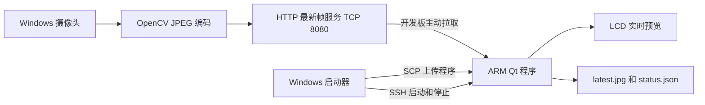

# Windows Camera to iMX6U

让没有实体摄像头的 Linux 开发板，通过网线使用 Windows 电脑上的摄像头。

Windows 用 OpenCV 采集和压缩画面，开发板主动获取最新 JPEG。板端原生 Qt 程序负责解码并在 LCD 上预览；也提供仅需 Python 标准库的无界面接收器。

此仓库只包含摄像头传输和显示，不含手语识别、MediaPipe、训练模型或数据集。没有创建虚拟 `/dev/videoN` 设备，后续程序应读取最新图像或接入 HTTP 接口。

## 架构



- 只有最新帧，不积压历史帧；允许多个客户端获取画面。
- 摄像头读取失败后重试，板端网络请求超时后自动重连。
- 约 2.5 秒没有新帧时，板端清除旧画面并提示过期。
- 一键部署、启动、停止；退出时恢复板端原桌面。
- 默认原始方向显示，不做镜像；图像保持宽高比。

## 已验证环境

| 项目 | 环境 |
|---|---|
| 电脑 | Windows 11、Python 3.12、OpenCV 4.11.0 |
| 开发板 | ATK-IMX6U、ARMv7 32 位、约 512 MB 内存 |
| 板端库 | Qt 5.12.9、QtNetwork、linuxfb 和 JPEG 插件 |
| 编译环境 | WSL2、Linaro GCC 5.5 ARM hard-float、匹配的 Qt SDK |
| 实测传输 | 320×180、板端预览约 4 fps |

这是特定硬件上的短时测试结果，不是任意开发板的性能保证。程序不要求板端安装 OpenCV；无界面接收器兼容 Python 3.5。

## 文件结构

```text
sender.py                 Windows 摄像头和 HTTP 服务
launch.py                 自动采集、SCP 部署、SSH 启动
stop.py                   停止启动器或清理板端残留服务
receiver.py               可选的 Python 无界面接收器
start_all.bat              一键启动
stop_all.bat               一键停止
board/main.cpp            ARM Qt 接收、解码和 LCD 显示
board/run_viewer.sh        屏幕环境和桌面恢复
board/service.sh           start / stop / status
tools/build_arm.sh         ARM 交叉编译
tools/verify_live.py        显式的真实摄像头与开发板测试
test_*.py                  无需摄像头的自动测试
```

仓库只跟踪源码。`bin/` 中的 ARM 程序、第三方 Qt 库、SDK、日志、截图、SSH 主机密钥和本机运行文件不上传。**首次克隆后先编译，才能使用一键 LCD 预览**；仅验证图像传输可以先使用 Python 接收器。

## 1 准备电脑

需要 Python 3.9+、Windows OpenSSH 的 `ssh` / `scp`，以及 OpenCV。

```powershell
python -m venv .venv
.\.venv\Scripts\python.exe -m pip install -r requirements-windows.txt
```

如果已有 `opencv-contrib-python`，可直接复用，不要同时安装另一种 `cv2` 包。批处理优先使用项目 `.venv`，其次复用现有 `qrushi` Conda 环境，否则使用 PATH 中的 Python。

## 2 连接开发板

示例直连地址如下，可根据实际网络通过参数修改：

| 设备 | IPv4 | 掩码 |
|---|---|---|
| Windows 有线网卡 | 192.168.1.100 | 255.255.255.0 |
| 开发板 | 192.168.1.4 | 255.255.255.0 |

确认开发板已进入 Linux，并且 SSH 可用。示例针对旧版 SSH 使用兼容选项：

```powershell
ssh -o HostKeyAlgorithms=+ssh-rsa root@192.168.1.4
```

一键流程使用 `BatchMode=yes`，需要已有可用的非交互 SSH 认证。按开发板现有账号配置认证，不要为了此项目关闭认证。主机指纹记录在本机 `.known_hosts` 中，该文件不上传。

## 3 准备 SDK 并交叉编译

需要与板端 Qt 版本和 ARM ABI 匹配的 SDK 及 sysroot。脚本默认查找 WSL 用户目录下的 `lab7-sdk`，使用以下结构：

```text
lab7-sdk/
  configure-build/bin/qmake
  configure-build/lib/
  gcc-linaro-5.5.0-2017.10-x86_64_arm-linux-gnueabihf/bin/
  board-sysroot/usr/lib/
  board-sysroot/lib/
```

SDK 若缺少用于链接的 QtNetwork，可从自己的匹配开发板复制，放入仓库本地的 `toolchain-libs/`：

```powershell
New-Item -ItemType Directory -Force toolchain-libs
scp -O -o HostKeyAlgorithms=+ssh-rsa `
  root@192.168.1.4:/usr/lib/libQt5Network.so.5.12.9 `
  .\toolchain-libs\
```

在 WSL 中进入克隆后的仓库目录：

```bash
export CAMERA_QT_SDK="$HOME/lab7-sdk"
bash tools/build_arm.sh
```

可选环境变量：`CAMERA_QMAKE`、`CAMERA_SYSROOT`、`CAMERA_CROSS_BIN`、`CAMERA_NETWORK_LIBDIR`。现有 Qt SDK 缺少 QtNetwork 链接时，脚本会在 `configure-build/lib/` 补充一个指向匹配板端库的链接；不会覆盖已有链接或安装板端系统库。

输出为 `bin/camera_viewer_arm`；日志和动态库依赖记录在 `build/arm/`。不提供从零搭建 SDK 的自动安装器。

## 4 一键运行

关闭其他占用电脑摄像头的软件，双击 `start_all.bat`，或：

```powershell
.\start_all.bat --host 192.168.1.100 --board 192.168.1.4
```

启动器打开电脑摄像头，通过旧版 SCP 上传 ARM 程序和服务脚本，然后通过 SSH 启动开发板全屏预览。SCP 的 `-O` 用于兼容旧板端，不代表设备一定不支持 SFTP。

默认请求 320×240、采集上限 10 fps、板端请求上限 5 fps、JPEG 质量 70。实际尺寸由摄像头协商；程序保留比例，不会强行拉伸。

```powershell
.\start_all.bat --camera 1 --width 640 --height 480 `
  --fps 10 --receive-fps 5 --quality 75 --port 8080
```

浏览器打开 `http://192.168.1.100:8080/` 查看同步预览。停止方式：

- 启动窗口按 Ctrl+C。
- 双击 `stop_all.bat`。
- 点开发板“退出并恢复桌面”。

活跃启动器收到停止请求后会清理两端；启动器已退出时，`stop_all.bat` 尝试停止默认地址 `192.168.1.4` 的板端服务。使用其他板端地址时，残留服务请按下面的 SSH 命令手动停止。

## 板端目录和服务

安装目录：`/home/root/camera_transport`。运行数据：`/tmp/camera_transport`。

| 文件 | 用途 |
|---|---|
| `latest.jpg` | 最新原始 JPEG，原子替换 |
| `status.json` | 状态、帧数、尺寸、速率和帧年龄 |
| `viewer.log` | 接收、错误和退出日志 |

```powershell
ssh -o HostKeyAlgorithms=+ssh-rsa root@192.168.1.4 `
  "sh /home/root/camera_transport/service.sh status"
ssh -o HostKeyAlgorithms=+ssh-rsa root@192.168.1.4 `
  "sh /home/root/camera_transport/service.sh stop"
```

脚本只暂停并恢复现有 QDesktop，不修改系统开机启动、不烧录固件。画面过期后保留的 `latest.jpg` 可能是旧图，使用它的程序需要结合状态判断。

## 无界面接收

不编译 Qt 也可以先测试传输。电脑运行：

```powershell
python sender.py --host 192.168.1.100
```

把 `receiver.py` 复制到开发板，然后在板端执行：

```sh
python3 -u receiver.py --server http://192.168.1.100:8080 \
  --output /tmp/camera_latest.jpg --max-frames 20 --max-errors 3
```

此模式仅保存最新图像，不显示 LCD。`start_sender.bat` 和 `start_receiver.bat` 是相应的旧版调试入口，不要与一键模式同时启动。

## HTTP 接口

| 接口 | 方法 | 说明 |
|---|---|---|
| `/` | GET | 浏览器预览 |
| `/status` | GET | 采集状态、尺寸、序号和错误 |
| `/frame.jpg` | GET | 最新 JPEG；无有效帧时返回 503 |

图像响应带有 `X-Frame-Sequence` 和 `X-Captured-At`；客户端可根据序号跳过重复帧。本项目未使用 NFS 挂载。

## 测试

自动测试仅使用 Python 标准库，不调用真实摄像头或开发板：

```powershell
python -m unittest discover -p "test_*.py" -v
```

GitHub Actions 在 Windows 和 Ubuntu 上运行这些测试；Windows 专属的进程锁测试在 Linux 上跳过。CI 不交叉编译 ARM，也不宣称完成硬件验证。

有限帧硬件测试：

```powershell
.\start_all.bat --max-frames 30 --duration 30
```

显式断线恢复测试（使用默认地址，先停止其他摄像头服务）：

```powershell
python tools/verify_live.py
```

它会打开真实摄像头并控制板端界面，测试最新帧接收、重复启动保护、发送中断、过期提示和恢复；结果保存到本地 `build/validation/`。历史验证见 [VALIDATION.md](VALIDATION.md)。

## 常见问题

- **摄像头打不开**：关闭其他摄像头应用，或更换 `--camera` 编号。
- **电脑有画面而板端超时**：检查有线地址和防火墙；必要时仅允许开发板访问电脑 TCP 8080，不要关闭整个防火墙。
- **Qt 提示缺库或 JPEG 插件**：检查板端现有 Qt 版本、动态库和 `/usr/lib/plugins/imageformats/libqjpeg.so`。
- **旧图误认为直播**：观察 `status.json` 的状态与帧年龄，而不是只检查 JPEG 文件是否存在。
- **退出后桌面没恢复**：网线断开时电脑无法远程清理，恢复连接后执行板端 stop。

## 使用边界

本方案使用可信直连局域网中的普通 HTTP，没有账号验证或加密；默认只监听指定有线 IP。不应直接暴露到互联网。仓库不包含 SSH 凭据、摄像头照片、第三方 Qt 库或手语识别工程。
